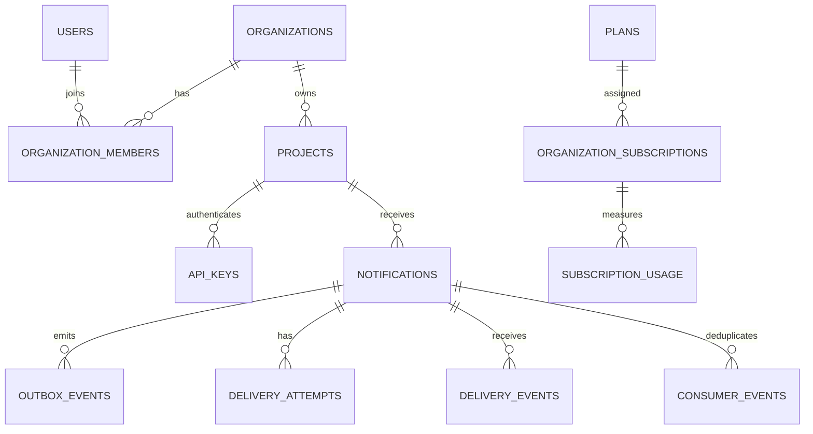

# NotifyX Database Design and Architecture

## Scope

This document describes the current PostgreSQL design and the asynchronous
notification architecture. Hibernate currently uses `ddl-auto=update` locally;
production should use versioned migrations.

## High-level flow

```text
API client
  -> project API-key authentication
  -> notification + outbox_events (one transaction)
  -> outbox publisher claims with SKIP LOCKED
  -> RabbitMQ priority queue
  -> idempotent consumer
  -> delivery_attempts
  -> Brevo email API
  -> Brevo webhook
  -> delivery_events
  -> authenticated tracking API
```

## Core relational model



## Tables and responsibilities

| Table | Responsibility | Important constraints |
|---|---|---|
| `users` | Dashboard identities | Unique email |
| `organizations` | Tenant boundary | Organization membership controls access |
| `organization_members` | User-to-organization access | Unique organization/user pair |
| `projects` | Isolated notification namespace | Unique organization/slug pair |
| `api_keys` | Project ingestion credentials | Store only a hash; support revocation/expiry |
| `plans` | Quota, channels, and priority entitlement | Plan priority is mapped to RabbitMQ priority |
| `organization_subscriptions` | Current organization entitlement | Active subscription is selected for quota checks |
| `subscription_usage` | Monthly quota reservation | Row is locked while incrementing usage |
| `notifications` | Business notification state | Unique project/idempotency key pair |
| `outbox_events` | Reliable publication intent | `PENDING`, `PROCESSING`, `PUBLISHED`, `FAILED` |
| `consumer_events` | Durable RabbitMQ deduplication | Unique event ID and stale-claim recovery |
| `delivery_attempts` | Provider attempt audit | Unique notification/attempt number |
| `delivery_events` | Brevo lifecycle analytics | Unique provider message/event pair |
| `billing_orders`, `payments` | One-time Razorpay billing | Provider IDs and payment state |
| `razorpay_webhook_events` | Razorpay webhook idempotency | Provider event ID is unique |

## Notification lifecycle

```text
ACCEPTED -> PROCESSING -> SENT
                    \-> FAILED
```

`scheduledAt` prevents outbox claiming until the notification is due. The
current consumer uses manual acknowledgements. A duplicate RabbitMQ delivery
is acknowledged without a second provider call.

## Outbox consistency

The notification and its outbox event are inserted in the same transaction.
Publishers claim rows with PostgreSQL `FOR UPDATE SKIP LOCKED`, commit the
claim before publishing, and use publisher confirms. A crashed publisher can
produce an at-least-once duplicate, so consumer idempotency is required.

Recommended production indexes:

```sql
CREATE INDEX idx_outbox_claim
    ON outbox_events (status, next_attempt_at, created_at);
CREATE INDEX idx_outbox_stale
    ON outbox_events (status, locked_at);
CREATE INDEX idx_delivery_message
    ON delivery_attempts (provider_message_id);
CREATE INDEX idx_delivery_events_message
    ON delivery_events (provider_message_id, event_type);
```

## RabbitMQ priority model

Plan priority is persisted on `notifications`, copied into the outbox payload,
then mapped by `OutboxPublisherService`:

```text
LOW=1, NORMAL=2, HIGH=3, CRITICAL=4
```

`notifyx.notification.queue` declares `x-max-priority=4`. Priority only orders
messages still waiting in the queue; prefetched messages may already be
assigned to consumers.

## Delivery analytics

The frontend reads:

```http
GET /api/v1/projects/{projectId}/notifications/{notificationId}
Authorization: Bearer <JWT>
```

The response combines notification state, all delivery attempts, Brevo's
provider message ID, provider response/errors, and lifecycle events such as
delivered, opened, clicked, bounced, blocked, spam, and invalid.

Brevo posts events to:

```http
POST /api/v1/webhooks/brevo
Authorization: Bearer <BREVO_WEBHOOK_SECRET>
```

Webhook rows are inserted idempotently using
`(provider_message_id, event_type)`.

## Architectural assessment

### Strengths

- Tenant isolation is represented by organization and project foreign keys.
- Ingestion idempotency protects quota and notification creation.
- Transactional outbox prevents a committed notification from losing its event.
- `SKIP LOCKED` supports multiple publisher instances.
- Publisher confirms and returned-message handling improve broker reliability.
- Consumer receipts prevent duplicate Brevo sends.
- Provider webhooks separate API acceptance from eventual delivery analytics.

### Compatibility and operational risks

- `ddl-auto=update` is not a migration strategy; use Flyway or Liquibase before
  production.
- Delivery is at-least-once, not exactly-once. Brevo provider idempotency should
  be used if supported.
- Consumer failures currently go directly to the DLQ; delayed retry queues are
  still a future improvement.
- Webhook authentication must use a separate secret, never the Brevo API key.
- Brevo webhook delivery requires a public HTTPS endpoint.
- Add retention policies for outbox, consumer receipt, delivery attempt, and
  delivery event data.
- Add metrics for queue depth, publish latency, delivery latency, webhook lag,
  failure rate, and DLQ depth.

## Source mapping

- [NotificationServiceImpl](src/main/java/com/beanstack/notifyx/notification/service/impl/NotificationServiceImpl.java)
- [OutboxPublisherService](src/main/java/com/beanstack/notifyx/outbox/service/OutboxPublisherService.java)
- [RabbitTopologyConfig](src/main/java/com/beanstack/notifyx/outbox/config/RabbitTopologyConfig.java)
- [NotificationEventConsumer](src/main/java/com/beanstack/notifyx/messaging/consumer/NotificationEventConsumer.java)
- [NotificationDeliveryService](src/main/java/com/beanstack/notifyx/delivery/service/NotificationDeliveryService.java)
- [BrevoWebhookService](src/main/java/com/beanstack/notifyx/delivery/service/BrevoWebhookService.java)
- [DeliveryTrackingController](src/main/java/com/beanstack/notifyx/delivery/controller/DeliveryTrackingController.java)
